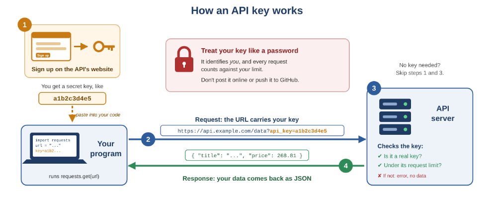

# Intro to APIs

An API lets your program ask another computer for data: you send a request to a URL and get back a response, usually JSON. Each example prints the raw response (needs `pip install requests`); the gray box shows part of it.

## How an API key works



1. **Sign up on the API's website.** You get a secret key, like `a1b2c3d4e5`, and paste it into your code.
2. **Your program sends a request. The URL carries your key:**

   ```
   https://api.example.com/data?api_key=a1b2c3d4e5
   ```

   ```python
   import requests

   key = "a1b2c3d4e5"
   url = "https://api.example.com/data?api_key=" + key
   response = requests.get(url)
   print(response.text)
   ```

3. **The API server checks the key:**
   - ✔ Is it a real key?
   - ✔ Is it under its request limit?
   - ✘ If not: you get an error and no data.
4. **The response comes back with your data as JSON:**

   ```json
   { "title": "...", "price": 268.81 }
   ```

> **No key needed?** Skip steps 1 and 3.

> 🔒 **Treat your key like a password.**
> It identifies *you*, and every request counts against *your* limit.
> Don't post it online or push it to GitHub.
